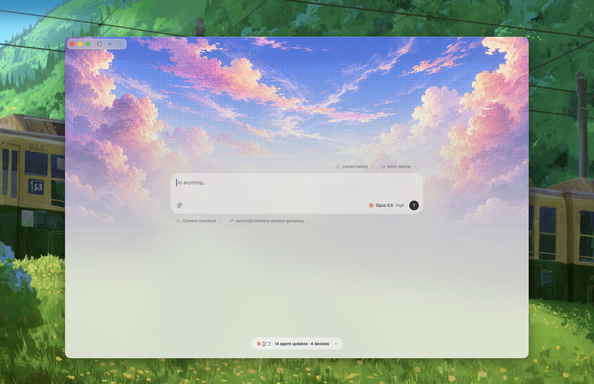

# RCode

로컬 우선 코딩 에이전트입니다. 에이전트 자체는 이 프로세스 안에서 실행되고, 설정한 모델 공급자에 연결합니다. 세션은 이 기기에 저장되며 모델 요청은 설정한 공급자에게 전송됩니다. RCode 계정은 필요하지 않습니다.

*[English](README.md) | [简体中文](README.zh-CN.md) | 한국어 | [日本語](README.ja.md) | [Español](README.es.md)*



## 데스크톱 앱

[GitHub Releases](https://github.com/chengliang4810/RCode/releases/latest)에서 플랫폼에 맞는 최신 버전을 내려받으세요.

- **macOS** — `rcode-macos-arm64.dmg`
- **Windows** — `rcode-windows-x86_64-setup.exe`
- **Linux** — `rcode-linux-<arch>.tar.gz`의 압축을 풀고 안에 있는 `install.sh` 실행

RCode 계정은 필요하지 않습니다. 모델 접근과 업데이트에는 네트워크를 사용하고, 세션은 기기에 저장됩니다. 앱은 자동으로 업데이트됩니다.

## 헤드리스 실행 (CLI)

서버처럼 디스플레이가 없는 머신용입니다. 예를 들어 노트북을 닫은 뒤에도 에이전트를 계속 돌려 두는 VPS에 쓰면 됩니다. Linux만 지원합니다.

```bash
curl -fsSL https://github.com/chengliang4810/RCode/releases/latest/download/install.sh | sh
rcode status
```

설치 스크립트는 엔진을 백그라운드 서비스로 실행하며, 재부팅 후에도 자동으로 다시 시작됩니다.

```bash
rcode status      # 엔진 상태 확인
rcode update      # 최신 버전으로 업데이트
rcode daemon start|stop|restart|status
```

---

개발에 참여하고 싶거나 동작 방식이 궁금하다면 [Ask DeepWiki](https://deepwiki.com/chengliang4810/RCode) 또는 [ARCHITECTURE.md](ARCHITECTURE.md)를 확인하세요.

[MIT License](LICENSE)로 배포됩니다.
