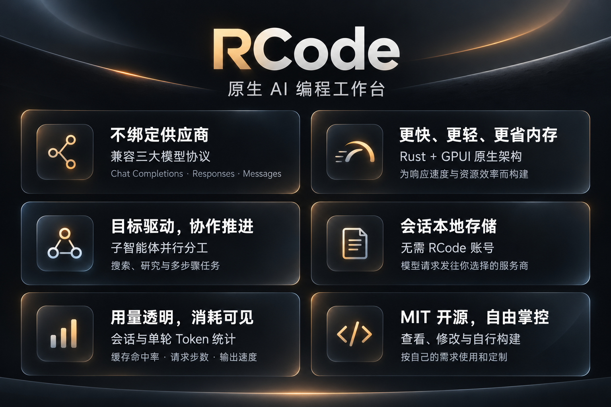

# RCode

不绑定供应商的原生 AI 编程工作台。

*[English](README.md) | 简体中文 | [한국어](README.ko.md) | [日本語](README.ja.md) | [Español](README.es.md)*




## 特点

### 不绑定供应商，兼容三大模型协议

支持 OpenAI Chat Completions、OpenAI Responses、Anthropic Messages，自由选择服务商与模型。

### Rust 原生桌面，为更快、更轻、更省内存而构建

以 Rust 与 GPUI 构建原生应用，结合增量更新、虚拟化渲染与缓存管理，优化响应速度和资源占用。支持 Windows、macOS、Linux。

### 目标驱动，子智能体并行协作

围绕明确目标持续推进，支持子智能体分工处理搜索、研究与多步骤任务。

### 会话本地存储，模型连接自主掌控

无需 RCode 账号，会话保存在本机，模型请求发往你配置的服务商。

### 用量透明，消耗清晰可见

会话与单轮 Token、缓存命中率、请求步数、输出速度，随时查看。

### MIT 开源，代码与部署自由掌控

支持源码查看、修改和自行构建，按自己的需求使用和定制。

## 桌面应用

从 [GitHub Releases](https://github.com/chengliang4810/RCode/releases/latest) 下载对应平台的最新版本：

- **macOS** — `rcode-macos-arm64.dmg`
- **Windows** — `rcode-windows-x86_64-setup.exe`
- **Linux** — `rcode-linux-<arch>.tar.gz`，解压后运行里面的 `install.sh`

无需 RCode 账号。模型访问和应用更新需要联网，会话保存在本机。应用支持自动更新。

## 无界面运行（CLI）

适用于服务器等没有显示器的机器，比如在你合上笔记本之后继续跑 agent 的 VPS。仅支持 Linux：

```bash
curl -fsSL https://github.com/chengliang4810/RCode/releases/latest/download/install.sh | sh
rcode status
```

安装脚本会把引擎作为后台服务拉起来，重启之后也会自己回来。

```bash
rcode status      # 查看引擎状态
rcode update      # 更新到最新版本
rcode daemon start|stop|restart|status
```

---

想参与开发，或者好奇它怎么跑起来的？[Ask DeepWiki](https://deepwiki.com/chengliang4810/RCode)，也可以看 [ARCHITECTURE.md](ARCHITECTURE.md)。

采用 [MIT License](LICENSE)。
