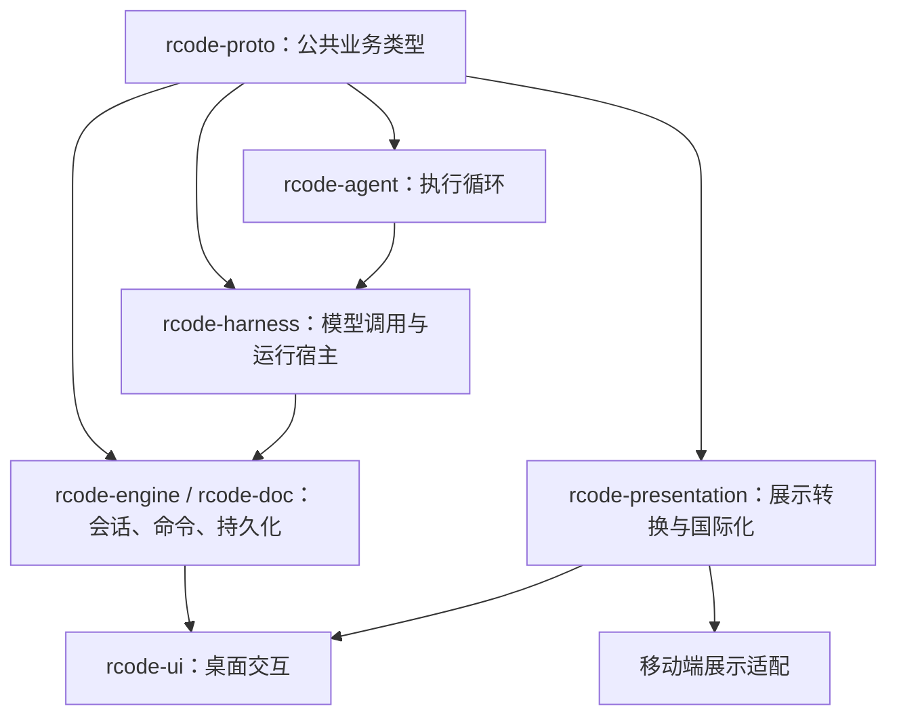
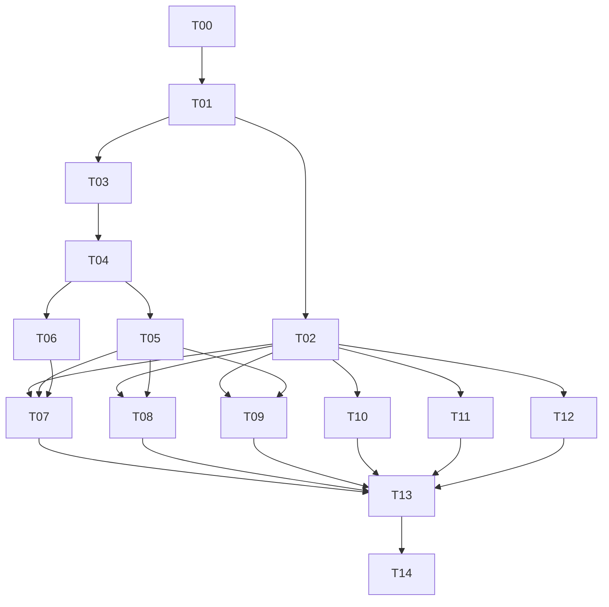

# RCode：UI／Agent 协议统一、桌面国际化与原生 Providers 设置实施计划

**拟保存文件：** `D:/projects/rcode/docs/design/ui-agent-i18n-implementation-plan.md`  
**规划依据：** 2026-10-13 对当前工作区的静态检查，以及本次对话中确认的产品选择。  
**文档状态：** 可供执行模型使用的完整交接正文。当前会话处于计划模式，规则禁止写入文件，因此本轮尚未创建该文件。

## 1. 交付目标、边界与执行原则

### 1.1 已确认的产品决定

| 项目 | 本轮决定 |
|---|---|
| 改造范围 | UI／Agent 协议统一和国际化一起实施 |
| 语言范围 | 完整桌面的简体中文和英文 |
| 切换方式 | 保存语言偏好，重启应用后生效 |
| Providers 设置 | 一并替换成原生 provider、模型、API Key 配置页面 |
| 历史兼容 | 允许重置开发数据，不承担旧会话格式迁移 |
| 平台验收 | Windows 实机主验收；macOS、Linux 做构建、测试并如实记录实机验证缺口 |
| 移动端 | 跟进公共接口变化，保持源码可构建；本轮不做完整 iOS 翻译 |
| 默认权限 | `Default`，不得为了方便测试而默认跳过授权 |

本轮完成后，用户应当能够：

1. 在设置中选择系统语言、简体中文或英文，重启后获得一致的界面语言。
2. 在界面中添加 provider、配置模型和凭据，保存后直接用于下一次运行。
3. 通过稳定、与显示文字无关的协议完成发送、停止、权限确认和问题回答。
4. 正确查看文本流、工具调用、执行结果、文件差异和运行状态。
5. 修改语言后继续查看本轮新格式生成的历史记录，应用生成的标签随语言改变，原始聊天内容保持原样。

### 1.2 本轮不扩展的功能

以下工作不作为本计划的附带任务：

- 新增模型供应商协议；继续使用现有三类协议。
- 实现原生 Agent 尚未完成的完整会话恢复、子 Agent、后台任务或语音能力。
- 改造云同步、远程传输、账户体系或项目品牌。
- 翻译用户输入、模型生成的正文、代码、终端输出、第三方错误详情。
- 支持旧版桌面或旧版移动端二进制与新版 Engine 混用。
- 修改与本任务无关的 UI 风格、字体系统或布局框架。

对于当前未实现的能力，界面必须依据真实能力隐藏入口或显示本地化的不可用说明，不得展示可操作但必然返回 `UnknownMethod` 的按钮。

### 1.3 实施前必须知道的现状

当前项目正在进行原生 Agent 重写，工作区包含其他任务的已暂存、未暂存和新增文件。实施开始时必须重新确认代码，不能根据本文中的旧行号直接覆盖。

本次检查确认：

- Agent 内部和公共协议中各有一套 `AgentEvent`，目前通过 `NativeHarness` 转换。
- 权限模式仍通过旧的 `sandbox`、`auto_approve` 参数间接表达。
- 权限回答通过英文显示标签解析。
- 部分展示文字位于 Agent 和 `rcode-proto` 中。
- Providers 配置文件和读写代码已经存在，但 `NativeHarness::models()` 当前仍返回空列表。
- 旧 Providers 页面仍围绕外部 CLI。
- 国际化资源和应用级语言设置尚未建立。
- 部分 CI 脚本仍引用已经删除的 feature 和测试目标。

当前代码入口包括：

- [原生 Agent 适配](D:/projects/rcode/crates/harness/src/native.rs)
- [Providers 配置](D:/projects/rcode/crates/harness/src/providers.rs)
- [公共协议](D:/projects/rcode/crates/proto/src/agent.rs)
- [会话运行管理](D:/projects/rcode/crates/engine/src/sessions.rs)
- [共享展示函数](D:/projects/rcode/crates/proto/src/view.rs)

### 1.4 所有执行模型必须遵守的规范

- 先阅读本计划及任务前置提交，再开始修改。
- 每个任务只修改分配给自己的文件；公共文件由集成负责人控制。
- 禁止全仓库替换英文字符串。
- 禁止使用中文、英文显示文字作为协议值、持久化键、控件 ID 或业务判断条件。
- 禁止在 Agent 中引入 GPUI、翻译服务、窗口状态或语言偏好。
- 禁止为了让检查通过而删除仍有意义的测试、降低断言或吞掉错误。
- 禁止覆盖、撤销或顺带提交原工作区中其他任务的改动。
- 不进行无关依赖升级、大规模重命名或整库格式化。
- 测试未运行、运行失败、平台不可用，必须分别记录。
- 遇到公共接口与计划冲突，提交具体问题给集成负责人；工作模型不得自行创造第二套接口。

## 2. 架构、接口与行为规范

### 2.1 最终依赖关系



图中的箭头表示类型被使用或数据流向，不要求新增对应的直接 Cargo 依赖。

固定以下职责：

| 层 | 负责内容 |
|---|---|
| `rcode-model` | 厂商请求、响应、流式协议及其转换 |
| `rcode-agent` | 模型循环、工具执行、权限策略、取消 |
| `rcode-harness` | 选择 provider、建立模型客户端、连接 Agent 与 Engine |
| `rcode-engine` | 运行生命周期、交互请求关联、命令执行与发布 |
| `rcode-doc` | 会话记录、事件折叠、命令账本、展示记录裁剪 |
| `rcode-proto` | 无语言、无界面依赖的公共业务类型 |
| 新增 `rcode-presentation` | 文案、工具展示、时间和数量格式化 |
| `rcode-ui` | 控件、用户操作、界面状态与渲染 |

保留 provider 消息转换、事件到文档的折叠、文档到界面状态的转换。收敛的是重复业务定义和旧界面兼容逻辑。

### 2.2 公共类型和事件收敛

#### 类型归属

在 `rcode-proto` 中建立独立的原生运行协议模块。最终由它唯一持有：

- `PermissionMode`
- `PermissionDecision`
- `InteractionRequest`
- `InteractionResponse`
- 问题、选项、回答的数据结构
- `ToolInvocation`
- `ToolOutput`
- `AgentEvent`
- 自有错误的结构化数据

Agent 可以重新导出这些类型，不能重新定义内容相同的枚举。

实施期间允许新模块与旧协议并存，以便分批编译。协议贯通完成后，必须删除重复定义和临时转换；不保留长期的旧格式兼容分支。

#### 运行请求

将原生运行路径中的权限参数统一为：

```rust
permission_mode: PermissionMode
```

同步修改会话配置、发送请求、队列重放和客户端构造路径。

- 默认值为 `Default`。
- 删除原生运行路径对 `auto_approve` 的依赖。
- 清理原生路径中没有实际沙箱实现支撑的 `SandboxLevel` 展示。
- 保留工具已有的路径检查和执行约束。
- 权限模式表达审批策略，不得被描述成操作系统级沙箱。
- `AutoMode` 类型可以保留；分类器未实现时，界面不允许将其选择为可用模式，后端返回明确的“不支持”错误。

#### 事件流

沿用现有公共 `AgentEvent` 的主要业务事件，调整以下内容：

| 事件 | 规定 |
|---|---|
| `SessionStarted` | 由宿主发出一次，包含运行身份和实际模型信息 |
| `TextDelta`、`ReasoningDelta` | Agent 直接输出公共类型，宿主原样转发 |
| `ModelStepCompleted` | 保存一次模型调用的消息 ID，不将其替换成文档条目 ID |
| `ToolCall` | 携带完整的 `ToolInvocation` |
| `ToolResult` | 携带统一的 `ToolOutput` |
| `InputRequested`、`InputResolved` | 由 Engine 的交互桥统一发布 |
| `Done` | 已接受运行必须有且仅有一个终态 |
| 已有图片、用量、子任务等事件 | 保留其独立语义，本轮不制造未实现的事件 |

`NativeHarness` 最终只做配置解析、宿主连接、启动信息补充和取消传递，不再维护逐项复制 `TextDelta` 等事件的 `from_agent_event`。

Agent 不再额外发送一个不能被 Engine 解析的权限请求事件。请求发布只保留一个入口，避免界面出现两个相同问题。

#### ID 规则

必须区分：

- `chat_id`：会话标识。
- `run_id`：一次被接受运行的标识。
- 文档消息 ID：聊天记录中消息条目的标识。
- 模型消息 ID：一次模型调用生成消息的标识。
- 工具调用 ID：工具请求和结果的关联标识。
- `request_id`：一次需要用户回答的交互标识。

Engine 负责运行和文档条目身份；Agent 保留模型消息和工具调用身份。模型步骤完成不得触发文档消息错误分段，也不得导致一个工具调用出现在两个条目里。

#### 工具数据与展示数据

统一业务数据：

```rust
struct ToolInvocation {
    id: String,
    name: String,
    input: serde_json::Value,
}

struct ToolOutput {
    output: String,
    is_error: bool,
    diff: Option<ToolDiff>,
}
```

具体 enum 变体中不要再重复定义另一种工具结果字段组合。

将现有偏展示用途的 `ToolCall` 类型明确命名为 `ToolPresentation`：

- 它用于文档和界面展示，不作为 Agent 执行工具的输入。
- 工具名与原始参数到展示类型的映射集中维护一处。
- 未识别工具必须有通用展示，不能被丢弃。
- 全量工具参数仍按当前规则保留在本地运行日志；聊天文档继续执行裁剪策略。
- `ToolDiff` 使用结构化类型，不能在工具层是字符串、事件层又强制写成 `None`。
- `Write`、`Edit` 在拥有实际前后内容时生成差异；不得通过猜测生成差异。

Agent 内部消息类型与 provider 消息类型暂不合并，它们承担不同职责。

### 2.3 统一用户交互

固定为同一条传输和等待链路，使用不同的业务变体：

```rust
enum InteractionRequest {
    Permission(PermissionRequest),
    Questions(QuestionRequest),
}

enum InteractionResponse {
    Permission(PermissionDecision),
    Questions(Vec<QuestionAnswer>),
    Dismissed,
}

enum PermissionDecision {
    AllowOnce,
    AllowToolForRun,
    Deny,
}
```

#### 权限请求

至少携带：

- 工具调用 ID。
- 工具名称。
- 用于详情展示的参数。
- 是否允许 `AllowToolForRun`。

界面根据请求生成本地化标题、操作摘要和按钮。

`AllowToolForRun` 的含义固定为：**同一次运行内，允许相同工具名称的后续调用**。不得扩大到其他会话、其他工具或未来运行。按钮文案必须清楚表达这个范围。

移除：

- `decision_from_labels`
- `"Allow"` 等标签到决定值的转换
- 通过 `permission:` 文本前缀识别交互类型的业务逻辑
- 空回答自动当成成功授权的可能路径

#### 普通问题

问题和选项必须有稳定 ID：

```rust
struct QuestionOption {
    id: String,
    label: String,
}

struct QuestionAnswer {
    question_id: String,
    selected_option_ids: Vec<String>,
    text: Option<String>,
}
```

其他现有字段，如题目、标题、多选、预填、多行，继续保留。

- 模型提供的题目和选项文字原样展示。
- 工具输入若只有选项字符串，由工具解析阶段按顺序生成选项 ID。
- 相同显示文字的两个选项仍然是不同选项。
- UI 返回 ID；只有工具结果组装阶段将 ID 映射回原始选项内容，供模型理解。
- 保留当前 `AskUserQuestion` 的问题数量和选项数量约束，并使 schema 与运行时校验一致。
- 未知 ID、重复 ID、单选题提交多项、错误回答类型，均应返回可识别的校验错误。

#### 交互生命周期

Engine 的待回答记录至少包含：

```text
chat_id + run_id + request_id + 原始请求 + 一次性回答通道
```

执行顺序：

1. 注册待回答记录。
2. 发布 `InputRequested`。
3. UI 经现有命令账本提交回答。
4. Engine 校验运行、请求和回答类型。
5. 正确回答只消费一次。
6. 发布 `InputResolved`。
7. Agent 恢复执行。

必须处理：

- 错误回答不能提前删除待回答记录。
- 重复回答不能重复执行工具。
- 旧运行的回答不能影响新运行。
- 停止、失败和结束时清理所有等待。
- 等待用户回答期间必须响应取消。
- 取消导致中断，不能被记录成“用户拒绝”或普通模型失败。
- 运行结束后的迟到回答不能将状态重新改为 `Working`。
- `Dismissed` 不授予权限；普通问题返回已取消结果。

### 2.4 原生 Providers 配置

#### 配置与存储

继续使用现有 `{data_dir}/providers.json`，保持与 UI 设置分离。

引入共享 `ProviderStore`，由 Engine 和 `NativeHarness` 持有同一个实例：

- 配置读取返回不可变快照。
- 保存成功后替换快照。
- 新运行获取新快照。
- 正在执行的运行保留启动时的 provider、模型和已解析凭据。
- 不在每个模型步骤中重新读取 provider 文件或重新选择默认模型。
- UI 不直接读写该文件。

`NativeHarness::models()` 必须从实际配置返回模型列表，不能继续返回空数组。

#### RPC 接口

新增以下本地设置接口，沿用项目现有 RPC 组织方式：

| 接口 | 用途 |
|---|---|
| `GetProviderSettings` | 读取可展示的 provider 配置和版本 |
| `SaveProviderSettings` | 校验并保存完整配置草稿 |
| `ListModels` | 返回当前配置的实际模型列表 |

读取响应包括配置版本、默认模型、provider 和模型信息、凭据状态。

读取响应不得包含明文 API Key。凭据写入使用明确操作：

```rust
enum CredentialUpdate {
    Keep,
    ReplaceLiteral { value: String },
    UseEnvironment { name: String },
    Clear,
}
```

- `Keep` 保留现有凭据，不把遮罩字符串写回文件。
- 环境变量模式继续兼容当前文件的 `$VAR` 表达。
- UI 可以看到环境变量名称和是否配置，不能收到其展开值。
- 含凭据的 DTO 不得派生会打印凭据的 `Debug`，日志也不能记录完整请求参数。
- 设置接口不加入远程转发名单。

保存请求包含 `expected_revision`。版本由当前文件内容的 SHA-256 指纹表示，缺失文件使用固定的空配置版本。

保存时在单一写入锁内：

1. 重新读取文件并检查版本。
2. 校验草稿和凭据操作。
3. 写入同目录唯一临时文件。
4. 完成文件写入后替换正式文件。
5. 成功后更新内存快照并返回新版本。

文件写入失败时，磁盘原配置和内存原快照均保持可用。版本冲突时返回冲突错误，UI 保留草稿并提示重新载入，不能覆盖另一个窗口或外部编辑器的修改。

损坏配置不得被静默解释成空配置后覆盖。

#### 字段规则

- Provider ID 非空、去除首尾空白、不可含控制字符，在配置中唯一。
- 模型 ID 使用相同规则，并且在所有 provider 中全局唯一。
- ID 区分大小写；修改现有 ID 按删除旧项和新增项处理。
- 厂商模型名称非空，独立于界面显示名称。
- 显示名称可以为空，使用现有回退规则。
- Base URL 允许 `http`、`https`，必须有合法主机；不得包含用户名、密码或 fragment。
- Base URL 留空时使用当前协议默认地址。
- `context_window`、`max_tokens` 若填写，必须是正整数；两者均填写时，后者不得大于前者。
- 默认模型若明确指定，必须存在。
- 没有明确默认值时沿用配置顺序中的首个模型。
- 允许保存尚未填写凭据的配置；运行时给出可定位到 provider 的错误。
- 删除当前默认模型前，UI 要求选择其他默认模型或清除默认值。
- 已有会话引用已删除模型时，要求用户重新选择，不能静默更换厂商。

首期不自动请求远程模型列表、不自动发测试请求、不根据模型名称猜测上下文窗口。新增设置所需的网络验证由离线模拟服务测试覆盖。

#### 页面行为

以原 Providers 页为入口，替换旧 CLI 安装、更新和账户切换流程。

页面必须包含：

- Provider 列表、新增、编辑、删除。
- 协议、名称、Base URL。
- 凭据状态、替换凭据、环境变量引用和清除。
- 模型列表及模型编辑。
- 默认模型选择。
- 保存、取消、保存中、保存失败、冲突和空状态。
- 未保存修改离开确认。
- 删除确认，说明对后续运行的影响。

普通输入复用现有控件。密钥输入使用已经存在的 `gpui_base::input::InputState::masked(true)` 能力，不另写一个文本编辑器，也不修改聊天输入框来实现密码遮罩。

保存成功后，模型选择器下次打开必须读取最新目录；新会话采用新默认模型。当前运行不中断。

### 2.5 国际化与展示层

#### 实现位置与依赖

新增：

```text
D:/projects/rcode/crates/presentation/
```

crate 名称固定为 `rcode-presentation`，内部包含国际化和纯展示函数，不依赖 GPUI、Engine 或 Agent 执行实现。

固定采用：

- `fluent-bundle = 0.16.0`
- `fluent-syntax = 0.12.0`
- `unic-langid` 的 `0.9` 系列
- `sys-locale = 0.3.2`

由集成负责人统一修改依赖并提交锁文件。Fluent 已提供参数和复数选择机制，本轮不编写自有模板语言。[Fluent 运行库](https://docs.rs/fluent-bundle/0.16.0/fluent_bundle/)、[复数与选择表达式](https://projectfluent.org/fluent/guide/selectors.html)、[系统语言读取](https://docs.rs/sys-locale/0.3.2/sys_locale/)。

#### 公开接口

```rust
enum LanguagePreference {
    System,
    EnUs,
    ZhCn,
}

enum Locale {
    EnUs,
    ZhCn,
}

struct Localizer { /* 已加载、只读的资源 */ }
```

`Localizer` 提供：

- 由偏好和系统语言解析实际语言。
- 无参数文案读取。
- 带参数文案格式化。
- 供测试使用的严格格式化接口。
- 格式化失败时的可记录错误类型。

UI 在启动读取设置后、创建原生菜单和窗口之前初始化语言。业务层不使用进程级语言全局变量；纯展示函数显式接收 `Localizer`，便于测试隔离。

#### 语言解析规则

- 默认偏好为 `System`。
- 系统首选语言的主语言是 `zh` 时使用简体中文。
- 其他语言或无法读取系统语言时使用英文。
- 手动选择优先于系统语言。
- 本轮不提供繁体中文资源。
- 无效或未知的已保存语言值回退 `System`，不能导致整个 UI 设置文件失效。

设置中显示“跟随系统／简体中文／English”。修改只保存偏好，并显示“重启后生效”。当前进程继续使用启动时语言，避免部分窗口提前切换。

#### 资源拆分与 Key

资源按语言和领域划分：

```text
locales/en-US/{common,shell,conversation,providers,settings,files,git,browser,terminal,errors}.ftl
locales/zh-CN/{相同领域}.ftl
```

- Key 使用稳定的小写连字符形式，例如 `permission-allow-once`。
- Key 不以整句英文充当 ID。
- 两种语言必须有相同 Key 和相同参数集合。
- 构建脚本从英文资源生成 `TextKey` 枚举，调用方使用枚举。
- 构建脚本同时检查重复 Key、语法错误、中文缺项和参数不匹配。
- 生成文件写到 Cargo `OUT_DIR`，工作模型不得手工编辑生成结果。
- 首期资源允许文本、参数、数字复数和选择表达式；不引入嵌套消息引用、属性和自定义函数，降低审计复杂度。
- 英文复数通过 Fluent 处理；中文使用完整的数量表达式。
- 运行时中文缺失或格式化失败回退英文，并仅记录 Key 和错误类别，不能记录可能包含秘密的参数。
- 发布前缺失翻译数必须为零，回退机制不能作为不完成翻译的理由。

资源在启动时解析一次。需要跨线程使用时采用 Fluent 的并发 Bundle，不在绘制或 token 流处理过程中重复解析资源。[并发 Bundle 接口](https://docs.rs/fluent-bundle/0.16.0/fluent_bundle/concurrent/type.FluentBundle.html)。

#### 展示逻辑迁移

从 `rcode-proto::view` 和 Agent 中移出会生成最终界面文字的函数，包括：

- 权限模式显示名称。
- 工具卡片名称与摘要。
- 工作完成摘要。
- 相对时间、运行时长和数量描述。
- 应用生成的状态及错误摘要。

无语言的排序、分组、状态判断继续留在原有公共模块。

展示函数返回 `String` 或其他明确拥有生命周期的值。不得通过 `Box::leak` 等方式继续满足旧的 `&'static str` 签名。

应用生成的标签和摘要尽量在显示时生成。新格式历史记录保存结构化状态和数量，不以当前语言的整句摘要作为唯一数据源。

#### 错误展示

新增自有错误结构：

```text
code + args + optional diagnostic
```

- `code` 为稳定业务代码，与显示语言无关。
- `args` 只携带生成提示所需的值。
- UI 通过错误代码选择本地化文案。
- 原始 provider、系统和命令输出作为技术详情展示。
- 未知错误使用本地化通用标题，不把翻译 Key 显示给用户。
- 不通过匹配英文错误字符串来决定按钮、状态或重试行为。

优先结构化覆盖：provider 配置、模型选择、权限交互、运行失败、设置保存、文件操作和 Engine 连接错误。

#### 翻译覆盖标准

完整桌面范围包括：

- 启动、连接、空状态与失败状态。
- 侧栏、会话、标签页、搜索、命令面板。
- 输入框、模型选择、权限确认和问题面板。
- 聊天工具卡片、队列、状态提示。
- 全部仍可访问的设置页面。
- 文件、编辑器外围菜单、图片与附件界面。
- Git、差异、历史及 PR 界面。
- 终端外围控件和浏览器外围控件。
- 原生应用菜单、通知、Toast、确认框和快捷键说明。

品牌、用户命名、文件路径、命令、协议标识、模型 ID 和工具执行名称保持原值。工具卡片的显示名称可以翻译。

统一术语：

| 英文 | 中文 |
|---|---|
| Provider | 服务商 |
| Model | 模型 |
| Agent | 智能体 |
| Session | 会话 |
| Run | 运行 |
| Workspace | 工作区 |
| Project | 项目 |
| Worktree | 工作树 |
| Reasoning | 推理 |
| Permission | 权限 |
| Archive | 归档 |

### 2.6 新数据格式与旧开发数据

允许不迁移旧数据，但禁止在启动时直接删除数据。

- 新会话格式定义 `DATA_SCHEMA_VERSION = 2`。
- 在 profile 存储目录中记录版本标记。
- 空 profile 可以初始化为新格式。
- 非空且无版本标记或版本不匹配时，返回结构化错误并阻止写入。
- 测试和开发验收使用单独的 `RCODE_DATA_DIR`。
- 旧目录由用户或集成负责人明确选择后归档，不能把“允许重置”理解成自动递归删除整个应用数据目录。
- `providers.json`、凭据、源代码仓库和工作树不得随会话数据重置一起删除。
- Engine 信息增加协议版本；客户端连接时检查。不兼容的旧 daemon 应得到明确提示，不继续发送新版命令。
- 本轮不增加旧事件反序列化适配器。

## 3. 工作包、串行依赖与并行安排

### 3.1 基线与分支规则

由一名集成负责人管理主集成分支。最多同时安排 **3 个实现工作模型和 1 个独立检查模型**。

每个实现任务使用独立工作树和分支。分支从已经通过前置验收的提交创建。

开始前：

1. 记录当前 HEAD、已暂存、未暂存和未跟踪文件。
2. 建立包含需要保留的当前内容的隔离基线。
3. 保留原工作区状态；不得直接提交其暂存区。
4. 基线快照与本计划功能提交分开标记。
5. 所有模型收到相同基线标识，不能各自从远端默认分支开始。
6. 实施过程中原工作区若继续变化，由集成负责人统一处理，工作模型不自行拉取覆盖。

中央共享文件由集成负责人维护：

- Workspace manifest 和锁文件。
- 公共协议导出。
- UI 启动注册。
- UI 设置存储结构。
- CI 总入口。
- 任务登记表。

工作模型需要修改这些文件时，提交准确的接口或补丁要求，由集成负责人在串行集成阶段应用。

### 3.2 工作包

| 编号 | 工作包 | 前置条件 | 修改范围和交付物 |
|---|---|---|---|
| T00 | 基线、清单和测试入口 | 无 | 固定代码基线；生成页面清单、文件归属和真实测试目标清单 |
| T01 | 公共接口冻结 | T00 | 公共类型、序列化样例、Providers RPC DTO、国际化公开接口；集成负责人控制 |
| T02 | 国际化基础 | T01 | 新 presentation crate、资源校验、Key 生成、语言解析；提供可独立测试的 API |
| T03 | Agent／Harness 协议改造 | T01 | 事件统一、权限类型、工具结果、取消、模型消息 ID |
| T04 | Engine／Doc 贯通 | T03 | 交互账本、生命周期、文档折叠、日志、协议与存储版本 |
| T05 | 客户端及交互 UI 贯通 | T04 | composer、回答流程、模型配置类型、client/mobile 必要接口更新 |
| T06 | Providers 后端 | T04 | ProviderStore、RPC、配置校验、保存、模型目录；与 T05 可并行 |
| T07 | Providers 页面及模型选择 | T02、T05、T06 | 原生设置表单、凭据编辑、模型列表刷新；本工作包独占 pickers |
| T08 | Shell 与通用设置翻译 | T02、T05 | shell、原生菜单、普通设置页；不修改 Providers 和 pickers |
| T09 | 会话展示翻译 | T02、T05 | transcript、composer、queue、工具卡片、运行状态 |
| T10 | 文件与媒体界面翻译 | T02 | files、附件、图片及对应资源 |
| T11 | Git／PR／历史翻译 | T02 | changes、history、pull request 等相关界面 |
| T12 | 浏览器／终端／辅助界面翻译 | T02 | browser、terminal、通知、Toast、剩余外围界面 |
| T13 | 全局收敛与 CI | T07—T12 | 清除临时兼容类型，补齐遗漏，合并检查工具，恢复有效 CI |
| T14 | 独立验收与交付 | T13 | 完整测试、Windows 实机、跨平台检查、证据和最终缺口说明 |

T02 与 T03 可以并行。T10—T12 可在国际化基础完成后与后端工作并行，按最多三个实现任务调度。

T03 → T04 → T05 必须串行，不允许三个模型同时修改互相依赖的事件和交互链路。

T07 与 T08/T09 可并行，但文件归属必须固定：

- `pickers.rs` 及 compact picker：T07。
- `composer.rs`：先 T05，再 T09。
- `transcript.rs`：T09。
- `shell.rs`：T08；Providers 页面挂载所需改动由集成负责人提前完成。
- 旧 harness 更新界面的删除与引用清理由集成负责人安排，不能同时分给 T07 和 T08。
- `state.rs` 的公共状态改动由集成负责人串行应用。

### 3.3 依赖图



### 3.4 各阶段的停靠点

**G0：可以分派任务**

- 实际测试目标已核对。
- 不存在两项活动任务拥有同一文件。
- 接口、DTO、Key 规则和资源分区已经固定。
- Providers、权限和事件样例已经写成测试输入。

**G1：协议贯通**

T03—T05 完成后，必须能通过模拟模型完成：

```text
发送 → 文本 → 工具调用 → 权限确认 → 工具结果 → 继续输出 → 结束
```

同时验证停止和拒绝路径。未通过 G1，不开始会话层的大规模翻译。

**G2：配置可用**

T06—T07 完成后，必须能从空配置通过界面添加 provider 和模型，保存后出现在模型选择器，并通过本地模拟服务完成一次运行。

**G3：翻译覆盖**

页面清单所有条目都有中英结果；不存在未归类的候选硬编码文案；资源检查通过。

**G4：交付**

全部必测项通过；Windows 提供实际界面和流程证据；其他平台结果及缺口清楚记录。

### 3.5 文件和资源所有权

T00 创建实施登记表，按文件记录唯一 owner，至少包括：

```text
task_id
file_path
resource_domain
depends_on
status
base_revision
verification_report
```

规则：

- 页面代码及对应中英文资源归同一个任务。
- `common.ftl` 由国际化基础负责人维护。
- 新文件默认继承所属目录 owner。
- 跨 owner 的修改必须先由集成负责人重新分配。
- 协议转换函数不能由两个任务各写一份。
- UI 类型签名改变引发的调用点修复，按文件 owner 分派，不直接越界修改。

### 3.6 构建资源管理

当前项目构建产物较大，开发并行不等于同时执行多个全量构建。

- 设置 `CARGO_INCREMENTAL=0`。
- 同一台机器同一时间只进行一个大型 Cargo 构建或链接。
- 集成负责人维护构建队列。
- 日常使用目标 crate 的检查和测试。
- 全量 release 构建只在集成节点及最终交付时执行。
- 不在多个工作树中各自生成完整 release 缓存。
- 工作模型不能自行执行 `cargo clean` 或删除其他任务缓存。
- 测试排队不影响继续阅读、实现或审查互不重叠的文件。

## 4. 测试、检查工具与验收标准

### 4.1 基线检查

先执行只读的目标发现：

```powershell
cargo metadata --no-deps --format-version 1 --locked
```

以结果核对 CI，而不是相信旧脚本中的名称。

本次已发现需要复核的旧引用包括：

- `rcode-harness/native-fixture`
- 部分 `codex_*` 测试目标
- `windows_native`
- `voice_orb_geometry`
- 旧的 harness tests 文件 glob

处理原则：

- 已被删除功能专属的目标从当前 native job 中移除。
- 仍然有意义的行为测试迁入原生 Agent 测试。
- 不使用“命令成功但实际运行零个测试”作为验收。
- 对预先存在的失败记录基线；本次改动新增的失败必须修复。

### 4.2 协议与权限必测项

| 场景 | 必须满足 |
|---|---|
| 普通文本运行 | 正确结束，无重复终态 |
| 多次模型步骤 | 模型消息 ID 保留，聊天记录不重复分段 |
| 多工具调用 | 调用和结果 ID 一一对应 |
| 工具失败 | 错误结果返回模型，状态和界面一致 |
| 文件修改 | 差异经过完整链路后仍存在 |
| 未知工具展示 | 显示通用卡片，不丢事件 |
| 允许一次 | 当前调用执行，不影响下一次审批 |
| 本次运行允许同工具 | 作用域符合约定，不跨运行 |
| 拒绝 | 工具不执行，拒绝作为工具结果反馈 |
| 权限界面中文 | 回传相同业务枚举，不依赖中文字面值 |
| 等待时停止 | 等待立即可取消，无悬挂通道 |
| 重复或过期回答 | 不重复执行、不恢复结束状态 |
| 错误回答类型 | 返回校验错误，正确回答仍可继续提交 |
| 普通问题多选和自由文本 | 原始用户内容正确到达模型 |
| 相同选项文字 | 根据选项 ID 区分 |
| 流消费端被丢弃 | 底层运行得到取消，不继续执行工具 |
| 新格式重启恢复记录 | 历史可读取；不声称实现了模型上下文恢复 |
| 不兼容协议或数据 | 明确失败，禁止继续写入 |

新增核心集成测试目标固定命名为：

- `native_interaction_contract`
- `native_provider_settings`
- `native_protocol_roundtrip`

测试放在适合其真实边界的 crate 中；Engine 级链路测试放在 Engine 集成测试目录。

### 4.3 Providers 必测项

- 缺失文件、空配置、损坏文件。
- Provider ID 和全局模型 ID 重复。
- 默认模型失效。
- URL 和数字字段不合法。
- 字面量凭据、环境变量凭据、缺失环境变量。
- `Keep`、替换、清除分别生效。
- 读取接口和日志不出现明文密钥。
- 遮罩字符串不会被写回文件。
- 保存失败不破坏原文件和内存配置。
- 两个编辑窗口产生版本冲突。
- 外部编辑配置后旧草稿不能覆盖。
- 保存后目录刷新。
- 正在运行的会话保留旧快照。
- 后续运行使用新配置。
- 删除模型后不静默切换厂商。

使用本地 HTTP 模拟服务器分别覆盖现有三类 provider 协议：

1. 文本流。
2. 工具调用和后续结果。
3. 流中断。
4. 认证错误。
5. 取消。

模拟服务使用临时目录和假凭据，不依赖真实付费 API。

### 4.4 国际化自动检查

在 `rcode-presentation` 增加：

- 资源解析测试。
- 两种语言 Key 一致性测试。
- 参数集合一致性测试。
- 复数测试：`0`、`1`、`2` 和较大数量。
- 语言选择、无效值和系统语言回退测试。
- 严格格式化测试，禁止静默漏参数。
- 关键业务枚举到显示文字的覆盖测试。
- 新格式数据不保存本地化权限标签的测试。
- 切换语言不改变协议序列化结果的测试。

增加检查工具：

```text
cargo run --locked -p rcode-presentation --bin check-i18n
```

它应检查资源，并扫描桌面展示代码、共享展示代码和本轮新增页面的候选硬编码文案。

扫描规则：

- 覆盖普通字符串、raw string、格式化字符串、菜单、tooltip、placeholder、通知和对话框入口。
- 注释、测试样例、资源文件不作为生产文案。
- 日志、协议值、品牌和用户内容入口使用逐项允许清单。
- 允许清单必须包含文件、稳定定位、字符串指纹和理由。
- 禁止通过允许整个目录、整个文件或所有英文来消除报告。
- 静态扫描结果须配合页面清单人工核对，不能宣称扫描覆盖了全部动态路径。

### 4.5 Windows 实机验收

使用隔离数据目录和模拟 provider，至少验证：

- 新安装空状态。
- 新建会话和发送。
- 文本流、推理显示、工具卡片。
- 文件写入差异。
- 权限允许、拒绝和停止。
- 普通问题回答。
- Providers 新增、保存、编辑和删除。
- 模型选择与默认模型。
- 所有设置分类。
- 文件、Git、终端、浏览器外围界面。
- 原生菜单、通知及错误提示。
- 语言修改后重启，验证保存和生效规则。
- 重启后查看历史，界面标签变更而原始正文保持不变。

布局组合：

| 维度 | 要求 |
|---|---|
| 语言 | 英文、简体中文 |
| 主题 | 浅色、深色 |
| 窗口 | 最小支持尺寸、常用尺寸 |
| 缩放 | Windows 100%、150% |
| 内容 | 长路径、较长标签、中文和英文混合 |
| 字体 | 中文无缺字方框，按钮和菜单无不可操作的截断 |

不要通过整体缩小字体解决中文布局问题。优先使用合理的宽度、换行、滚动和有完整 tooltip 的截断。

每类核心界面保存实际截图和操作记录。截图中的凭据必须为假数据。

### 4.6 测试命令与执行层次

依赖和锁文件更新完成后，常规检查统一使用 `--locked`。

基础检查：

```powershell
$env:CARGO_INCREMENTAL = '0'
cargo fmt --all -- --check
cargo check --workspace --locked
```

纯逻辑和核心单元测试：

```powershell
cargo test --locked -p rcode-proto -p rcode-presentation -p rcode-agent -p rcode-model -p rcode-harness -p rcode-doc -p rcode-rpc -p rcode-engine -p rcode-client --lib
```

本轮新增集成测试：

```powershell
cargo test --locked -p rcode-engine --test native_interaction_contract --test native_provider_settings --test native_protocol_roundtrip
```

UI 测试使用现有原生初始化隔离方式：

```powershell
cargo test --locked -p rcode-ui --lib native_diff_font_geometry -- --test-threads=1
cargo test --locked -p rcode-ui --lib -- --test-threads=1 --skip native_diff_font_geometry
```

T00 必须确认这些过滤条件仍有真实测试。若入口因基线变化调整，更新命令和清单，不能接受零测试成功。

最终再执行一次 release 构建和 Windows 实机流程。日常任务不反复执行昂贵的全量 release 链接。

macOS、Linux：

- 在对应系统运行构建和适用测试。
- 需要修改 UniFFI 导出时，使用项目生成脚本更新绑定，禁止手改生成文件。
- 缺少对应平台执行环境时，记录“未验证”，不得根据 Windows 成功推导其他平台成功。
- 移动端本轮只验公共协议适配和可构建性，不宣称完成移动端国际化。

## 5. 集成、交接与最终完成条件

### 5.1 每个工作模型的交付报告

固定使用以下格式：

```text
任务编号：
基线提交：
实现提交：

完成的行为：
修改文件：
新增或改变的公开接口：
资源 Key 范围：

测试命令：
运行测试数量：
退出状态：
日志位置：

未运行的检查及原因：
已知问题：
需要集成负责人应用的公共文件变更：
```

禁止只提交“已完成”“测试通过”之类无法核对的说明。

### 5.2 集成负责人流程

每合入一个工作包：

1. 检查修改是否越界。
2. 检查是否出现重复业务类型、标签判断或临时硬编码。
3. 检查测试是否确实覆盖行为变化。
4. 按依赖顺序应用公共文件变更。
5. 运行对应验证。
6. 记录新的可用基线。
7. 再启动依赖该任务的工作包。

协议迁移期间允许内部集成分支存在短暂跨 crate 编译不一致，但必须限制在 T03—T05 的串行窗口内；不得把这种中间状态交给翻译工作模型作为稳定基线。

每个阶段通过后再更新实施登记表。测试失败的任务不能标为完成。

### 5.3 独立检查职责

独立检查模型不承担同一工作包的实现，重点检查：

- 是否仍有显示文字参与权限或状态判断。
- 是否仍存在相同语义的重复事件类型。
- 是否丢失工具差异、调用 ID 或终态。
- 是否有 UI 直接读写 Providers 配置。
- 是否出现凭据回传或日志泄漏。
- 是否还有失效的 CLI 安装／更新入口。
- 是否通过扩大允许清单掩盖漏翻译。
- 是否越界修改原有工作。
- CI 是否真实运行了对应测试。

发现问题必须给出文件、位置、触发场景和影响。由对应任务 owner 修复，再重新验收。

### 5.4 最终交付物

完成后交付：

1. 本计划文件及最终实施状态。
2. 公共协议与 Providers RPC 的简明说明。
3. 中英文资源及术语表。
4. 页面覆盖清单。
5. 文件所有权和任务完成记录。
6. 自动测试报告。
7. Windows 实机截图和流程记录。
8. macOS、Linux、移动端构建结果及验证缺口。
9. 新格式开发数据的使用与重置说明。
10. 已知限制，包括本轮未实现的原生 Agent 能力。

### 5.5 完成判定

全部满足以下条件，才可以宣布本轮完成：

- Agent、Harness、Engine 使用同一套公共业务定义。
- 权限与普通问题通过统一机制传输，回答与显示语言解耦。
- 文本、工具结果、差异和结束状态通过完整链路验证。
- Providers 可从界面配置，模型目录真实可用，保存具有明确生效规则。
- 现有可访问桌面界面的中英文覆盖完成。
- 中文资源不存在未解释的缺失 Key 或参数错误。
- 原生菜单、通知和失败状态纳入验收。
- 新数据格式明确，不会静默破坏旧开发数据。
- 旧接口临时转换和失效 UI 入口已清理。
- 自动检查和 Windows 实机验收完成。
- 其他平台的已验证结果与未验证部分明确区分。
- 每项任务都有提交、测试和证据记录。

### 5.6 可直接分派给工作模型的任务提示模板

> 阅读完整实施计划，执行任务 `{TASK_ID}`。  
> 工作基线为 `{BASE_REVISION}`，依赖任务 `{DEPENDENCIES}` 已通过验收。  
> 你只拥有 `{OWNED_FILES}` 及 `{RESOURCE_DOMAINS}` 的修改权限。  
> 严格使用计划定义的公共接口、业务语义、语言规则和测试标准。  
> 先检查当前实现，再修改；不要根据旧行号整段覆盖。  
> 不修改其他模型负责的文件，不顺带重构，不放宽测试，不增加第二套协议。  
> 需要调整公共文件时，提交准确的变更要求给集成负责人。  
> 按规定运行或排队运行测试，并使用固定交付报告格式提交结果。  
> 未验证的内容必须标明，不能以编译成功代替流程和界面验收。

