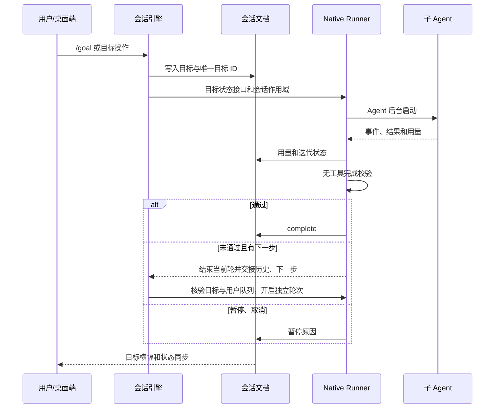

# 目标模式与子 Agent 管理

参照本机 ZCode 的目标续跑和 Agent 工具契约，使用 RCode 现有的 Native Agent、会话文档和子会话展示。

## 目标

- `/goal <目标>` 创建并开始会话目标。不为普通请求自动创建目标。
- `/goal` 查看；`pause` 暂停；`resume` 继续；`clear` 清除；`replace <目标>` 显式替换。未完成目标不得被静默覆盖。
- 不设置 Token 预算，也不因 Token 数量触发限额停止；用量仅用于统计。
- 会话文档是目标状态的持久化所有者。状态为 active、paused、complete；保存目标 ID、迭代次数、用量、耗时和最近校验原因。
- 每轮自然结束时独立执行无工具的完成校验。通过才完成；未通过且存在明确下一步才续跑；校验错误或无有效下一步时暂停并显示原因。待办未完成或子 Agent 仍在执行时不能完成。
- 停止、用户暂停、目标被替换后均不得继续旧目标。恢复会话后展示持久化状态，不在应用启动时自动消耗模型额度。

## 子 Agent

- `Agent` 是创建子 Agent 的唯一工具入口，支持前台与后台，复用角色定义和模型配置；不再注册或解析 `Task`。
- `TaskList` 列出当前会话的任务，`TaskOutput` 查询或可取消地等待，`TaskStop` 停止指定任务。
- `SendMessage` 向运行中的子 Agent 投递下一步骤消息；已完成的子 Agent 使用原角色和历史继续后台执行。
- 同一会话的父 Agent 才能管理其子 Agent；子 Agent 不得递归创建或管理其他会话任务。
- 后台任务允许并行执行，沿用全局并发上限。任务管理 ID 和恢复用的模型历史保留于当前应用进程；重启后仍可查看持久化的子会话记录，旧管理 ID 不再可用。主轮允许先结束；后台任务归会话运行时所有，停止主轮只取消前台任务。关闭会话运行时或应用退出会停止并回收全部任务。
- 子任务输出继续通过既有嵌套事件写入子会话；结果和错误必须可见，禁止后台异常静默丢失。

## 状态与事件

## 验收

覆盖目标创建/替换/暂停/继续/清除、文档往返、验证通过/不通过/非法响应、暂停后旧验证返回、后台并行、等待/取消、消息投递/恢复、会话隔离及无递归。

## 前后台任务对齐

- Native 会话运行时保持事件通道；后台 Agent 在主轮结束后继续写入原子会话。完成结果按任务代次去重，在步骤边界注入；主轮空闲时自动启动下一轮处理，用户排队消息优先。自动唤醒不确认或移除用户消息队列。
- Agent 支持显式后台、`auto_background_ms` 可选等待时长以及 `TaskBackground` 手动转换；桌面子对话提供“转为后台”。转换保留原任务、进程、历史和工具调用标识，不重新执行。
- Bash 加入同一会话任务表，支持 `run_in_background`。前台等待 `timeout` 秒后转后台，`auto_background=false` 可保留超时终止；纯 sleep 等等待命令默认不自动转后台。后台无隐式超时，使用 TaskStop 或运行时退出结束进程树。
- TaskList/TaskOutput/TaskStop/TaskBackground 同时管理 local_agent、local_bash；SendMessage 只针对 Agent。输出限制、日志路径、失败和停止状态均可查询。
- 目标有后台工作尚未返回时不执行完成判定；完成通知只驱动仍然有效的目标，不能恢复被用户暂停、清除或替换的旧目标。停止后仍接收结果，但不自动继续执行，下一次用户请求再消费通知。
- 验证覆盖主轮先结束、后台事件持续落盘、自动唤醒与去重、前台停止隔离、手动/定时转换、同一进程延续、输出/停止、运行时清理及用户队列优先。

实现使用 `native_session` 保持会话流；`BackgroundWake` 明确区分后台完成和用户 Steered，避免后台结果误确认用户消息。任务结果日志保存在系统临时目录 `rcode-task-output`。任务管理状态仍为进程内状态，应用退出会回收任务，不承诺退出后继续执行。

任务表最多保留 256 项；容量满时回收最早已回传的结束任务，保留日志文件，不删除运行中或尚未回传的后台结果。

## 目标独立轮次与历史窗口

- Native 目标每次完成校验未通过且有下一步时，结束当前助手轮，保存完整模型历史，并在同一会话开启独立助手消息。内部续跑提示不产生用户气泡，不通过 continuation_of 把多轮重新合并。
- 自动续跑必须再次核对目标 ID、修订号和 active 状态；用户已接受的消息优先。停止、暂停、替换、清除目标使旧续跑失效。轮次各自记录耗时，目标累计耗时及用量保持原所有权。
- 桌面历史订阅初始只读取尾部最多 128 个消息部件；保留完整部件，不截断文本或修改持久化内容。后续不会自动加载全部历史。已存在的单个超长文本部件属于完整性例外。
- 历史窗口由宿主按原始消息/部件游标维护，向上滚动时扩展一页。实时更新只覆盖当前窗口；更早编辑/删除由下次按需读取恢复。新消息不挤掉正在阅读的窗口。
- 接受新窗口前旧视图继续可用；重连恢复当前游标。前插保留稳定消息、部件与行 ID，以及可见行和偏移，禁止跳底。子对话和旧客户端保留原全量订阅协议。
- 窗口订阅持有文档/同步查看租约，不创建全历史镜像。订阅先于首次读取，避免读写缝隙。分页和重连采用新的权威窗口，避免旧异步帧覆盖新页面。
- 验证覆盖多轮独立记录与恢复、目标取消/修改时序、首帧范围、无自动全量补齐、前插不重不漏、并发新增/删除、游标失效、旧客户端兼容、可视锚点及大历史打开场景。

验证记录：
- Native 集成测试使用本机隔离的模型协议桩完成三次工作/校验，确认一条用户记录、三条不同 ID 的完整助手记录，每轮单独耗时，快照导入后记录一致。
- 历史文档、实时订阅和 RPC 测试覆盖尾部 128 部件、分页到 256 部件、无自动全量补齐、增量流式追加、游标失效、旧分段 ID 与旧全量协议。
- Windows 隔离窗口使用真实 IPC、Shell 和 Transcript，403 个部件首屏只加载 128 个；分页后 256 个，可见行 old#part-285.0 的偏移保持为 23px。截图与结果：target/ui-qa/history-window。该窗口使用合成记录，不请求外部模型。
- 2,000 部件的投影测试首帧为 262,921 字节，完整序列化为 4,076,997 字节；这不是完整桌面冷启动测量。Loro 文档仍按现有机制打开，优化针对消息解码、传输、Markdown 准备和列表展示；单个旧超长文本部件仍整体读取。

## 连续对话的消息身份

- SteerMessage.message_id 是用户消息的投递标识，Native 续接不能把它作为下一条助手消息的 ID。每个助手轮次使用独立标识；引擎还会拒绝驱动提供的已存在消息 ID。
- 冷打开时检查旧文档中的重复 ID，保留用户原始 ID，以不可变的 Loro 容器标识为冲突记录生成确定的新 ID，并修正旧续接引用。修复只改变身份元数据；原始会话快照保存在 <chatId>.pre-message-id-repair，正文、工具结果、顺序、状态与耗时保留。
- 验证：旧记录修复/跨副本一致性/增量追加、原始快照/落盘重开、Native 前后台续接、驱动重复 ID 拦截、三轮目标和历史窗口实时追加均通过。
